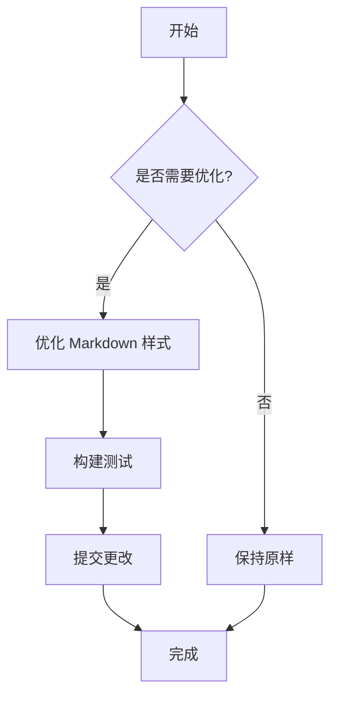

# Markdown 样式预览

这是新的 markdown 渲染样式预览文档，展示了所有主要的 markdown 元素。

## 标题层级

### 三级标题
#### 四级标题
##### 五级标题
###### 六级标题

## 文本样式

这是普通段落文本。**这是粗体文本**，*这是斜体文本*，~~这是删除线文本~~。

你也可以组合使用：***粗斜体***。

## 引用块

> 这是一个引用块。
> 
> 引用块可以包含多个段落，并且现在有更好的视觉效果。
> 
> > 这是嵌套的引用块。

## 列表

### 无序列表

- 第一项
- 第二项
  - 嵌套项 2.1
  - 嵌套项 2.2
    - 深层嵌套项
- 第三项

### 有序列表

1. 第一步
2. 第二步
   1. 子步骤 2.1
   2. 子步骤 2.2
3. 第三步

### 任务列表

- [x] 已完成的任务
- [ ] 待完成的任务
- [ ] 另一个待完成的任务

## 代码

### 内联代码

这是 `内联代码`，使用 `const variable = 'value'` 这样的语法。

### 代码块

```javascript
// JavaScript 代码示例
function greet(name) {
  console.log(`Hello, ${name}!`);
  return `Welcome to ${name}'s world`;
}

const result = greet('BiBit');
console.log(result);
```

```python
# Python 代码示例
def fibonacci(n):
    if n <= 1:
        return n
    return fibonacci(n-1) + fibonacci(n-2)

# 计算前 10 个斐波那契数
for i in range(10):
    print(f"F({i}) = {fibonacci(i)}")
```

## 表格

| 特性 | 旧样式 | 新样式 |
|------|--------|--------|
| 标题边框 | 无 | ✓ |
| 表格悬停效果 | 无 | ✓ |
| 斑马纹 | 无 | ✓ |
| 代码块边框 | 无 | ✓ |
| 引用块背景 | 无 | ✓ |

## 链接

[这是一个链接](https://example.com)

## 图片


## 水平分隔线

---

## 定义列表

术语 1
: 这是术语 1 的定义

术语 2
: 这是术语 2 的定义
: 术语可以有多个定义

## 键盘按键

按 <kbd>Ctrl</kbd> + <kbd>C</kbd> 复制，按 <kbd>Ctrl</kbd> + <kbd>V</kbd> 粘贴。

## 数学公式

行内公式：$E = mc^2$

块级公式：

$$
\int_{-\infty}^{\infty} e^{-x^2} dx = \sqrt{\pi}
$$

## Mermaid 图表



## 改进总结

### 主要改进点

1. **标题样式**：h1 和 h2 添加了底部边框，更接近 GitHub 风格
2. **表格**：添加了悬停效果和斑马纹，提升可读性
3. **代码块**：改进了边框和内边距，使其更加醒目
4. **引用块**：添加了背景色和圆角，视觉层次更清晰
5. **链接**：优化了悬停效果，增强交互反馈
6. **整体间距**：统一了元素间距，使用 16px 基准

### 兼容性

- ✓ 完全兼容现有的 Streamdown 功能
- ✓ 保留了 cot-markdown 紧凑样式
- ✓ 不影响工具调用块、思考卡片等特殊元素
- ✓ 支持浅色/深色主题切换

---

**测试建议**：在 BiBit GUI 中打开此文档，查看所有元素的渲染效果。
